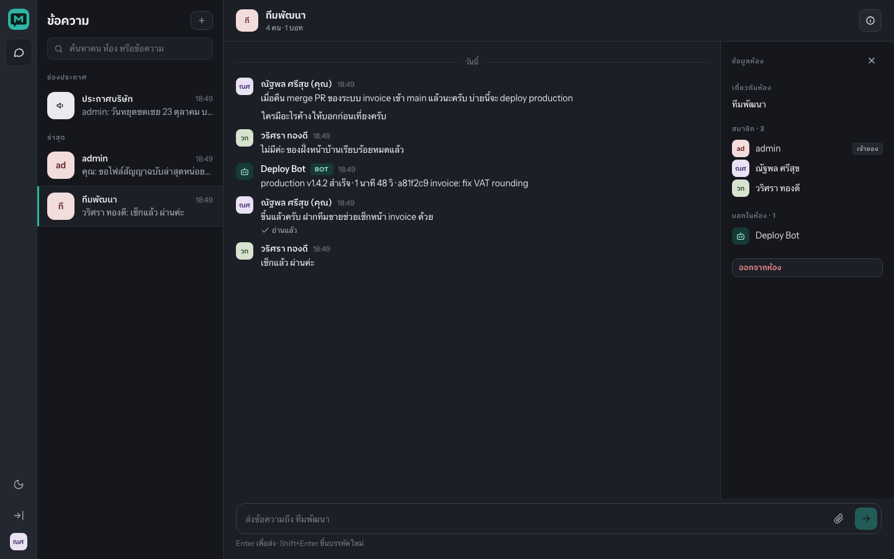
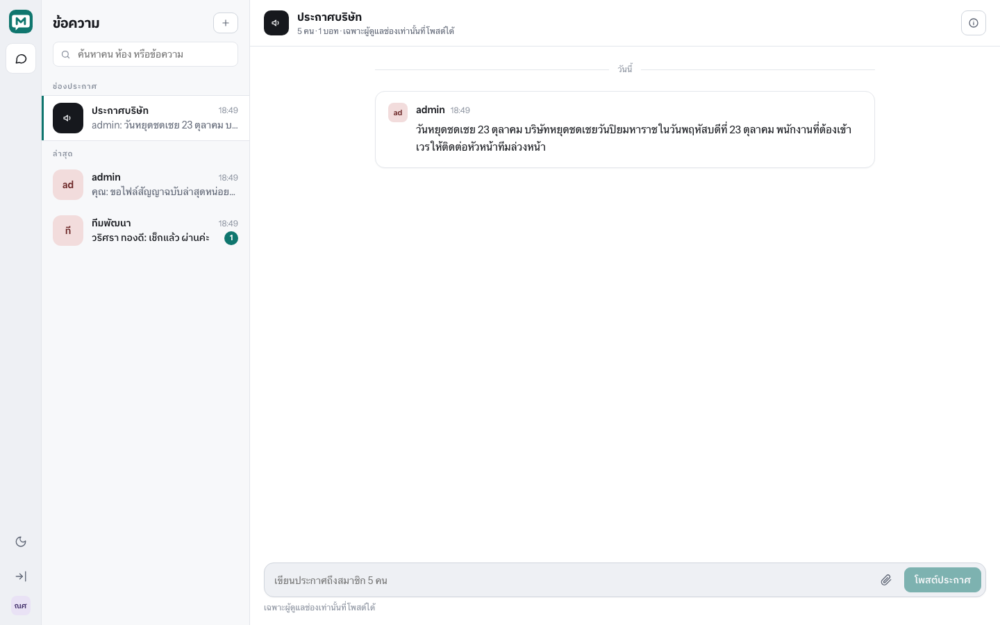

<p align="center">
  <picture>
    <source media="(prefers-color-scheme: dark)" srcset="brand/messario-wordmark-dark.svg">
    
  </picture>
</p>
<p align="center">
  Self-hosted team chat for organizations.<br>
  One Go binary, one PostgreSQL, a Telegram-style bot API. Your data stays on your servers.
</p>
<p align="center">
  <a href="#quick-start">Quick start</a> ·
  <a href="#deploy-for-a-customer">Deploy</a> ·
  <a href="#bots">Bots</a> ·
  <a href="docs/reference.md">Reference</a> ·
  <a href="https://b1ll1eee.github.io/messario/">Website (ไทย)</a>
</p>

<table>
  <tr>
    <td></td>
    <td></td>
  </tr>
  <tr>
    <td align="center">Team chat, read receipts, bots in the room</td>
    <td align="center">Dark mode follows the OS or a toggle</td>
  </tr>
  <tr>
    <td></td>
    <td align="center"></td>
  </tr>
  <tr>
    <td align="center">Announcement channels: admins post, everyone reads</td>
    <td align="center">Works on a phone from the same URL</td>
  </tr>
</table>

## Why

LINE and Telegram keep your company's conversations on someone else's
servers and give you no admin. Teams, Mattermost and Rocket.Chat solve that
but are heavy to run. Messario is the small option: install it on one machine,
add your people, point your internal systems at the bot API.

| You get | Who it is for |
|---|---|
| Direct chats, groups (≤200), announcement channels | Everyone in the company |
| Read receipts: live in 1:1, "seen by N" in groups and channels | Managers, HR |
| Files and images, stored on your disk or your S3 bucket | Everyone |
| Bot API shaped like Telegram's: `sendMessage`, `getUpdates`, webhooks | Developers, ERP/HR/monitoring integrations |
| Admin page: users, suspend on exit, bots and tokens, audit log | IT |
| Offline license keys with seat limits; free community tier (10 seats) | The vendor and the buyer |
| Thai-first UI, light and dark, desktop and phone | Thai organizations |

## Quick start

```sh
git clone https://github.com/b1ll1eee/messario && cd messario
make db-up            # PostgreSQL 17 in Docker
make init ORG="My Company" ADMIN=admin PASSWORD='change-me-now'
make web              # build the Vue client into the binary
make run              # http://localhost:8080
```

Log in as the admin, add a user from the admin page, open a chat. To seed
a demo with Thai users, a bot, a group and a channel:

```sh
PASSWORD='change-me-now' scripts/demo.sh
```

## Deploy for a customer

One Compose file brings up Messario, PostgreSQL and Caddy, which obtains the
TLS certificate for your domain by itself.

```sh
cd deploy
cp .env.example .env    # MESSARIO_DOMAIN, POSTGRES_PASSWORD, MESSARIO_LICENSE
docker compose up -d
docker compose exec messario /app/messario init \
  --org "My Company" --admin admin --password 'change-me'
```

Update with `docker compose pull && docker compose up -d`; migrations run on
start. Back up the `postgres-data` and `messario-data` volumes. A 2 vCPU / 4 GB
machine serves several hundred people.

## Bots

Create a bot in the admin page and copy its token (shown once). Then:

```sh
curl -X POST https://chat.example.com/bot/<TOKEN>/sendMessage \
  -H 'Content-Type: application/json' \
  -d '{"chat_id": 42, "text": "Deploy of v1.4.2 succeeded"}'
```

Receive messages with long-polling (`getUpdates`) or a webhook
(`setWebhook`), send files with `sendDocument`. If you have written a
Telegram bot, the shape is the same. Full list in the
[reference](docs/reference.md#bot-api).

## Licensing

Without a key the server runs the community edition: 10 active people,
unlimited bots. Keys are ed25519-signed and verified offline, so nothing
calls home. An expired key falls back to community limits instead of
locking anyone out.

```sh
go run ./cmd/licensegen keygen       # vendor, once: keep the private key safe
go run ./cmd/licensegen issue -key <private> -org "ACME" -seats 100 -days 365
```

## Everyday commands

```sh
make build      # bin/messario with the version stamped in
make web-dev    # Vite dev server on :5173, proxied to the API on :8080
make test       # unit tests + PostgreSQL integration tests
make vet
docker build -t messario .
```

<details>
<summary>Design in one paragraph</summary>

Hexagonal and deliberately light: `internal/domain` holds the entities and
rules, `internal/app` the use cases and the ports they need, and each
technology is one adapter (`postgres`, `httpapi`, `ws`, `memhub`,
`filestore`, `webhook`, `obs`). Messages carry a gap-free per-chat sequence
so clients resync after a reconnect with `after_seq`, and a
`client_msg_id` makes retries idempotent. The in-memory hub serves one
instance; swap it for NATS when you need more. Optional telemetry goes to
[Vindice](https://github.com/b1ll1eee/vindice-observability) over
OpenTelemetry. Diagram and data model in the
[reference](docs/reference.md#architecture).
</details>

## Status

Phases 1–3 are done and tested: backend, web client, files, bots with
webhooks, licensing, Docker delivery. Not yet built: SSO, message search,
push notifications, message retention and export. See
[docs/reference.md](docs/reference.md) for configuration and the full API.

MIT licensed.
