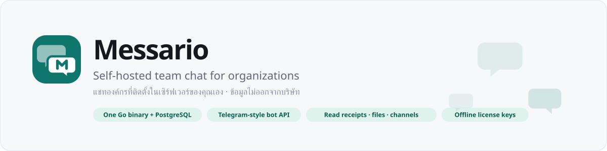
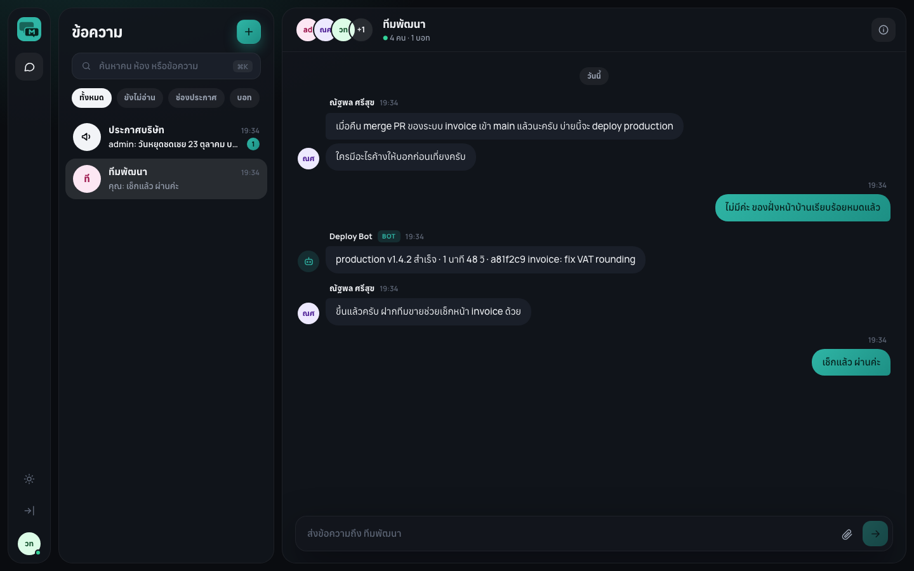
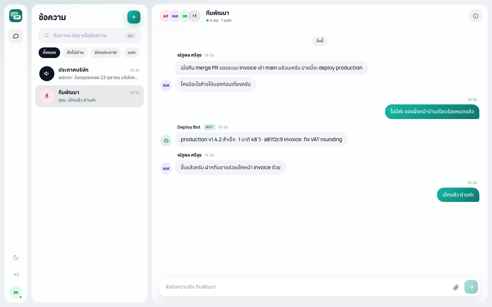
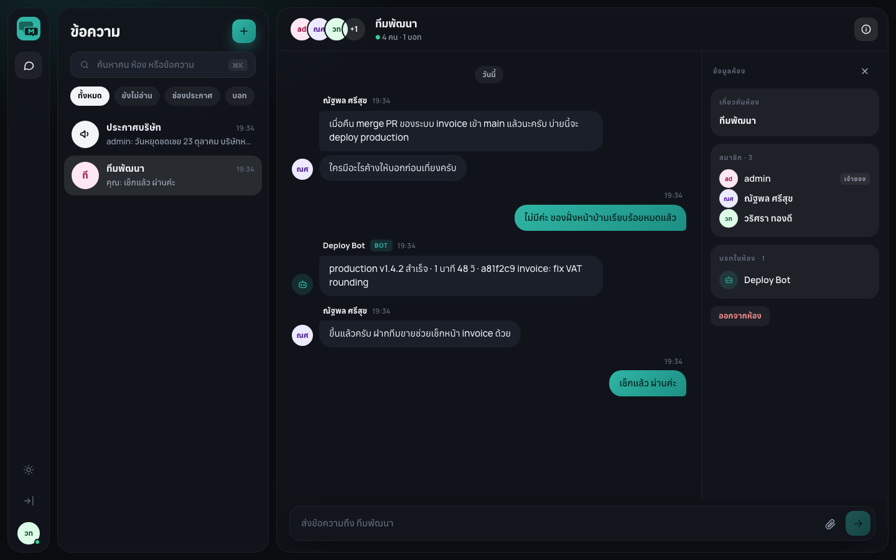
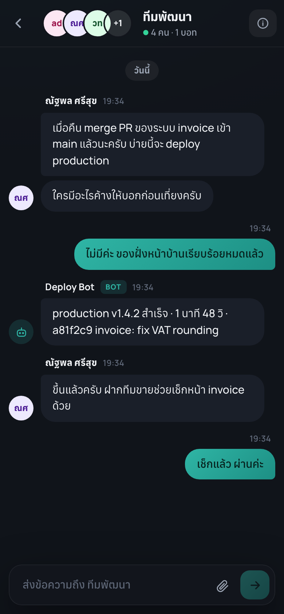
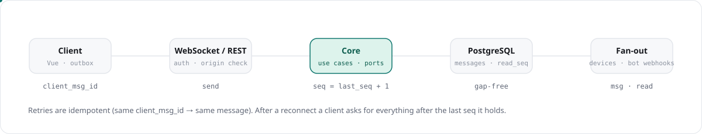

<picture>
  <source media="(prefers-color-scheme: dark)" srcset="docs/hero-dark.svg">
  
</picture>

<p align="center">
  <a href="#quick-start">Quick start</a> ·
  <a href="#deploy-for-a-customer">Deploy</a> ·
  <a href="#bots">Bots</a> ·
  <a href="#how-it-works">How it works</a> ·
  <a href="docs/reference.md">Reference</a> ·
  <a href="https://b1ll1eee.github.io/messario/">Website (ไทย)</a>
</p>

<details>
<summary><b>ภาษาไทย</b></summary>

Messario คือระบบแชทสำหรับองค์กรที่ติดตั้งบนเซิร์ฟเวอร์ของบริษัทเอง
ไฟล์เดียวกับ PostgreSQL หนึ่งตัว มีแชทส่วนตัว กลุ่ม ช่องประกาศ ส่งไฟล์
อ่านแล้ว และ Bot API แบบเดียวกับ Telegram สำหรับต่อ ERP/HR/monitoring
ข้อมูลไม่ออกจากบริษัท ติดตั้งด้วย Docker Compose ใน 15 นาที
Community edition ฟรี 10 ที่นั่ง รายละเอียดและราคาที่
[เว็บไซต์](https://b1ll1eee.github.io/messario/)
</details>

<picture>
  <source media="(prefers-color-scheme: dark)" srcset="docs/demo-dark.svg">
  
</picture>

## Why Messario

LINE and Telegram keep your company's conversations on someone else's
servers with no admin controls. Teams, Mattermost and Rocket.Chat fix that
but take a team to run. Messario is the small option: one machine, your
people, your internal systems posting through the bot API.

| | **Messario** | LINE | Microsoft Teams | Mattermost |
|---|:---:|:---:|:---:|:---:|
| Data stays on your servers | ✅ | ❌ | ❌ | ✅ |
| Admin can remove a leaver instantly | ✅ | ❌ | ✅ | ✅ |
| Runs on a 2 vCPU / 4 GB box | ✅ | – | ❌ | ⚠️ |
| Telegram-compatible bot API | ✅ | ❌ | ❌ | ❌ |
| Pay once, verified offline | ✅ | – | ❌ | ❌ |
| Thai-first interface | ✅ | ✅ | ⚠️ | ❌ |

| You get | Who it is for |
|---|---|
| Direct chats, groups (≤200), announcement channels | Everyone in the company |
| Read receipts: live in 1:1, "seen by N" in groups and channels | Managers, HR |
| Files and images on your disk or your S3 bucket | Everyone |
| Bot API shaped like Telegram's: `sendMessage`, `getUpdates`, webhooks | Developers, ERP/HR/monitoring integrations |
| Admin page: users, suspend on exit, bots and tokens, audit log | IT |
| Offline license keys with seat limits; free community tier (10 seats) | The vendor and the buyer |
| Dark and light themes, desktop and phone, Thai and English | Thai organizations |

<table>
  <tr>
    <td></td>
    <td></td>
  </tr>
  <tr>
    <td align="center">Team chat, read receipts, bots in the room</td>
    <td align="center">Light theme, one tap away</td>
  </tr>
  <tr>
    <td></td>
    <td align="center"></td>
  </tr>
  <tr>
    <td align="center">Room panel: members, bots, add or remove</td>
    <td align="center">Works on a phone from the same URL</td>
  </tr>
</table>

## Quick start

```sh
git clone https://github.com/b1ll1eee/messario && cd messario
make db-up            # PostgreSQL 17 in Docker
make init ORG="My Company" ADMIN=admin PASSWORD='change-me-now'
make web              # build the Vue client into the binary
make run              # http://localhost:8080
```

Log in as the admin, add a user from the admin page, open a chat. For a
ready-made demo with Thai users, a bot, a group and a channel:

```sh
PASSWORD='change-me-now' scripts/demo.sh
```

## Deploy for a customer

One Compose file brings up Messario, PostgreSQL and Caddy, which obtains
the TLS certificate for your domain by itself.

```sh
cd deploy
cp .env.example .env    # MESSARIO_DOMAIN, POSTGRES_PASSWORD, MESSARIO_LICENSE
docker compose up -d
docker compose exec messario /app/messario init \
  --org "My Company" --admin admin --password 'change-me'
```

Images are published to `ghcr.io/b1ll1eee/messario` for amd64 and arm64.
Update with `docker compose pull && docker compose up -d`; migrations run
on start. Back up the `postgres-data` and `messario-data` volumes.

## Bots

Create a bot in the admin page and copy its token (shown once). Anything
that can make an HTTP call can post into a chat:

```sh
curl -X POST https://chat.example.com/bot/<TOKEN>/sendMessage \
  -H 'Content-Type: application/json' \
  -d '{"chat_id": 42, "text": "Deploy of v1.4.2 succeeded"}'
```

<details>
<summary>Python and Go examples</summary>

```python
import requests
requests.post(f"https://chat.example.com/bot/{TOKEN}/sendMessage",
              json={"chat_id": 42, "text": "Backup finished: 12.4 GB"})
```

```go
body := strings.NewReader(`{"chat_id": 42, "text": "Backup finished: 12.4 GB"}`)
http.Post("https://chat.example.com/bot/"+token+"/sendMessage", "application/json", body)
```
</details>

Receive messages with long-polling (`getUpdates`) or a webhook
(`setWebhook`); send files with `sendDocument`. If you have written a
Telegram bot, the shape is the same. Full list in the
[reference](docs/reference.md#bot-api).

## How it works

<picture>
  <source media="(prefers-color-scheme: dark)" srcset="docs/flow-dark.svg">
  
</picture>

Hexagonal and deliberately light: `internal/domain` holds the entities and
rules, `internal/app` the use cases and the ports they need, and each
technology is one adapter (`postgres`, `httpapi`, `ws`, `memhub`,
`filestore`, `webhook`, `obs`). The in-memory hub serves one instance;
swap it for NATS when you need more. Optional telemetry goes to
[Vindice](https://github.com/b1ll1eee/vindice-observability) over
OpenTelemetry. Data model and the full API are in the
[reference](docs/reference.md#architecture).

## Licensing

Without a key the server runs the community edition: 10 active people,
unlimited bots. Keys are ed25519-signed and verified offline, so nothing
calls home. An expired key falls back to community limits instead of
locking anyone out.

```sh
go run ./cmd/licensegen keygen       # vendor, once: keep the private key safe
go run ./cmd/licensegen issue -key <private> -org "ACME" -seats 100 -days 365
```

## Everyday commands

```sh
make build      # bin/messario with the version stamped in
make web-dev    # Vite dev server on :5173, proxied to the API on :8080
make test       # unit tests + PostgreSQL integration tests
make vet
docker build -t messario .
python3 scripts/gen_logo.py           # brand assets from one source
python3 scripts/gen_readme_assets.py  # the illustrations on this page
```

## Status

Backend, web client, files, bots with webhooks, licensing and Docker
delivery are done and tested; CI runs unit and PostgreSQL integration
tests on every push. Not yet built: SSO, message search, push
notifications, message retention and export.

MIT licensed.
